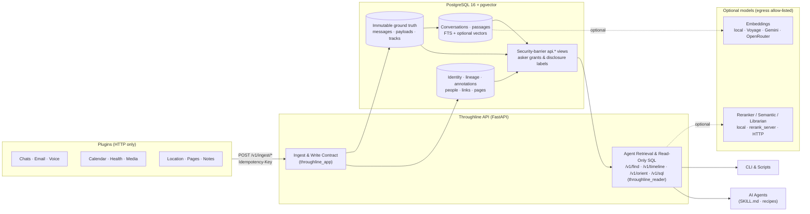

# Throughline

**Your life's record in one PostgreSQL database, built for AI agents to search and verify.**

[](https://github.com/joey12725/throughline/actions/workflows/ci.yml)


[](LICENSE)

Throughline is a free (GPL-3.0-or-later), self-hosted personal data hub. Independent source plugins ingest messages, voice transcripts, email, calendar events, health telemetry, media history, location tracks and curated pages over HTTP. Everything lands as immutable ground truth behind one identity registry, one access gate, and a stable, read-only SQL and retrieval surface.

Most personal-memory setups either hand an agent a raw vector store with no context or ask prompts to enforce guarantees that belong in the database. Throughline puts those guarantees in PostgreSQL: versioned ground truth, resolved people across networks, explicit coverage gaps, database-enforced privacy boundaries, idempotent writes with receipts, and retrieval endpoints shaped for an agent's context window. The core needs no model keys and sends nothing off your machine by default.

## How it fits together



- **No core-to-plugin coupling.** Core modules never import plugins or the SDK. Plugins are independent packages (Python, Node, or any language) that speak the [HTTP contract](docs/plugin-http-contract.md).
- **Split database roles.** The API connects as `throughline_app` (insert ground truth, no deletes) for writes and `throughline_reader` (read-only transactions, AST-validated `SELECT`, statement timeout, byte cap) for queries. Only local owner administration uses the superuser connection.
- **Offline by default.** Without any model variables configured, ingest, full-text search, SQL, timelines, people queries, coverage, feeds, and deterministic local reranking work with zero outbound network calls.

## What it does

- **Immutable ground truth.** Messages, raw payloads, timestamps and location tracks are never overwritten in place. Edits create version chains with SHA-256 payload hashes; corrections and noise flags live in separate annotations.
- **Agent-shaped retrieval, not bare chunks.**
  - `POST /v1/find` runs hybrid keyword + semantic search and returns compact *episodes* with surrounding thread context, owner-local timestamps, `(owner)` markers, `matched_people` IDs, and `later_in_thread` / `newer_in_pool` hints.
  - `POST /v1/timeline` runs exhaustive keyword + optional semantic search across synonyms, grouped into episodes in chronological order with per-year/channel counts and coverage.
  - `POST /v1/orient` returns a one-call working-memory snapshot: visible channels, recent telemetry, strictly-future calendar events, voice summaries, active chat threads, and optional per-person catch-ups.
  - `POST /v1/sql` exposes AST-validated read-only PostgreSQL over stable `api.*` views, per-channel typed views (`api.ch_<channel>`), and semantic operators (`api.recall`, `api.expand`, `api.match`, optional `api.librarian`).
- **One identity spine across every account.** Resolve people across chat handles, emails, phone numbers and enrolled voices with reversible merges and splits. Suspected accounts count for nobody until confirmed. Query `api.person_brief`, `api.dms_with`, `api.last_contact`, `api.open_loops`, `api.between`, `api.circle`, `api.ties`, `api.person_arc` and `api.day`.
- **Honest about evidence and gaps.** Every returned record carries its `evidence_class` (`primary`, `normalized`, `derived`, `inference`) and provenance chain; generated text is always flagged. Source coverage records partial syncs and gaps so agents report "not found in covered sources" instead of claiming something never happened.
- **Database-enforced access boundaries.** Registered askers get channel and thread grants enforced inside PostgreSQL security-barrier views — closing SQL error oracles and propagating privacy automatically through derived pages, passages, result sets and caches. Sensitivity labels (`intimate`, `medical`, `financial`, `work`, `third_party_confidence`, or custom) narrow grants by default and support expiring access.
- **Label-aware egress control.** Non-loopback model hosts are refused before a socket opens unless listed in `THROUGHLINE_EGRESS_ALLOW`. Labelled content is held back from remote providers unless the owner explicitly allows egress for that label.
- **Idempotent write contract.** Record writes accept an `Idempotency-Key`, return same-transaction readback receipts (`stored_hash`, `version`, `replayed`), support compare-and-set (`expected_version` / `expected_hash`), and resolve provisional message aliases without duplicates.
- **Built to run unattended.** Source health tracking detects failing, silent and arrival-cadence-stalled connectors, records outages and verifies catch-up. Named feeds (arrival cursors) guarantee exactly-once downstream processing. Snapshot-consistent backups encrypt dumps, copy off-site, run automated scratch-DB restore drills, and expose staleness alarms.

## Quickstart (Docker)

You need Docker with Compose 2.24 or newer, `git`, `curl` and (for the pretty
output below) `jq`. Nothing else: no Python, no model keys, no accounts.

```sh
git clone https://github.com/joey12725/throughline.git throughline
cd throughline
scripts/install.sh
```

That is the whole install. It writes `.env` with random passwords
(owner-only permissions), builds one image, starts PostgreSQL 16
(`pgvector/pgvector:pg16`), runs the one-shot `migrate` service (migrations
and runtime role passwords), starts the API on `http://127.0.0.1:8000` and the
`maintenance` scheduler (embedding worker, lenses,
source alerts, backups), then creates the owner token and prints it
once. The token is also saved as `THROUGHLINE_TOKEN` in `.env`, and stored in
the database only as a SHA-256 hash.

**1. Use the owner token in this shell.**

```sh
export THROUGHLINE_TOKEN="$(sed -n 's/^THROUGHLINE_TOKEN=//p' .env)"
```

**2. Seed the public twin**, a deterministic two-year synthetic corpus
(`fixtures/`): 12 invented people across two chat networks, voice
transcripts, media views, wiki pages and location visits. No personal data.

```sh
docker compose exec -T -e THROUGHLINE_URL=http://127.0.0.1:8000 \
  -e THROUGHLINE_TOKEN="$THROUGHLINE_TOKEN" throughline python -m fixtures --seed 47
```

**3. Search it.**

```sh
curl -s http://127.0.0.1:8000/v1/find \
  -H "Authorization: Bearer $THROUGHLINE_TOKEN" -H 'Content-Type: application/json' \
  -d '{"query": "purple kites", "k": 1}' \
  | jq -c '[.episodes[0].messages[] | select(.hit) | {channel, external_id, text}]'
```

Expected output (the twin is the same on every machine):

```json
[{"channel":"twin.fakewire","external_id":"fake-0-1","text":"Invented orchard 0 with Floop Lantern: purple kites"}]
```

Without `jq` the full response shows the episode: the hit, the messages
around it in its thread, `later_in_thread`, `newer_in_pool` and what was
searched. `GET /v1/openapi.json` (authenticated) documents every route.

**4. Finish setup in the browser (optional).** The API prints a one-time setup
link (`docker compose logs throughline | grep setup=`). The onboarding wizard
creates your sign-in account, takes your own model keys if you want any
(OpenRouter, Voyage, OpenAI, Anthropic, Gemini, a CLI proxy or local models),
connects an existing Immich, lets you pick only the sources you use (or paste
a GitHub link to a plugin repository), imports history with live progress,
works out who's who across sources and connects your agents over MCP.
`throughline lib setup prompt` prints a prompt that walks any agent through
the same steps. See [docs/onboarding.md](docs/onboarding.md).

Install options: `--timezone Europe/Berlin` (default: the host's zone),
`--port 8100`, `--bind 0.0.0.0` (for desktops on a trusted network; otherwise
use an HTTPS reverse proxy), `--connectors` (server connectors: see
[docs/companion.md](docs/companion.md#server-connectors-and-maintenance-in-docker)),
`--no-maintenance`. Run it again at any time to apply changed settings; it
never replaces a password or a token that exists. Put optional settings in
`throughline.env` (see [.env.example](.env.example)) rather than editing
`docker-compose.yml`.

Only the one-shot `migrate` service and the `maintenance` scheduler get the
superuser password; the API connects as `throughline_app` and
`throughline_reader`. Owner commands run in `migrate`:

```sh
docker compose run --rm migrate throughline token list
```

To update later, run `scripts/update.sh`: it rebuilds, snapshots the
database before any migration, restarts, and puts the old version back on
its own if anything fails. Data, tokens, settings and desktop pairings are
kept ([docs/updating.md](docs/updating.md)). To remove the demo entirely:
`docker compose down -v` (this deletes the database volume).

## Giving an agent access

An agent should get its own token, tied to a **restricted asker** that sees
only the channels you grant. Continuing the quickstart, give an agent the
`twin.fakechat` channel and nothing else:

```sh
docker compose run --rm -T migrate throughline lib asker add demo-agent
docker compose run --rm -T migrate throughline lib asker grant demo-agent --channel twin.fakechat
AGENT_TOKEN="$(docker compose run --rm -T migrate \
  throughline token create demo-agent --kind agent --asker demo-agent --json | jq -r .token)"
```

The same search with the agent's token only finds `twin.fakechat`:

```sh
curl -s http://127.0.0.1:8000/v1/find \
  -H "Authorization: Bearer $AGENT_TOKEN" -H 'Content-Type: application/json' \
  -d '{"query": "purple kites", "k": 1}' \
  | jq -c '[.episodes[0].messages[] | select(.hit) | {channel, external_id, text}]'
# [{"channel":"twin.fakechat","external_id":"fake-4-0","text":"Invented orchard 4 with Nimble Starbucket: purple kites"}]
```

and the second chat channel, `twin.fakewire`, does not exist for it, even in
SQL counts (the owner sees six channels here):

```sh
curl -s http://127.0.0.1:8000/v1/sql \
  -H "Authorization: Bearer $AGENT_TOKEN" -H 'Content-Type: application/json' \
  -d '{"statement": "SELECT channel, count(*) AS n FROM api.messages GROUP BY 1 ORDER BY 1"}' \
  | jq -c .rows
# [{"channel":"twin.fakechat","n":1460}]
```

The boundary is enforced inside PostgreSQL (security-barrier `api.*` views),
so it holds for every route, SQL, derived pages, passages and caches alike.
An agent token created **without** `--asker` is not restricted: it reads
what the owner reads. Grants can be narrowed by sensitivity label and can
expire ([docs/v11/access.md](docs/v11/access.md)).

Point the agent at [`skill/throughline/SKILL.md`](skill/throughline/SKILL.md)
with `THROUGHLINE_URL` and its token. The skill is host-neutral and teaches the
tool order:

1. `POST /v1/find` for topic discovery (compact episodes with context and follow-up hints).
2. `SELECT * FROM api.context(id, before, after)` to read around key hits.
3. `api.person('name')` and `api.person_brief(id)` for any question about a person.
4. `POST /v1/timeline` for exhaustive counts, recurring issues and long-term patterns.
5. `POST /v1/orient` for current telemetry, upcoming schedule and active threads.
6. `POST /v1/sql` for exact date ranges, telemetry series, per-channel views and aggregations.
7. `GET /v1/describe` for channel schemas, functions and tested query recipes (`src/throughline/recipes/`).

Full guide: [docs/agent-retrieval.md](docs/agent-retrieval.md).

## Local development (uv)

Requires Python 3.12+, [uv](https://docs.astral.sh/uv/), and PostgreSQL 16 with `vector`, `pg_trgm`, `cube` and `earthdistance`. Create an empty database and set `THROUGHLINE_DATABASE_URL`, `THROUGHLINE_APP_PASSWORD` and `THROUGHLINE_READER_PASSWORD` (or set `THROUGHLINE_DEV=1` against a local trust-authenticated PostgreSQL server):

```sh
uv sync --all-packages
uv run throughline migrate
uv run throughline configure-passwords
uv run throughline token create owner --json
uv run throughline serve
```

Point the CLI at the running server and seed the twin:

```sh
export THROUGHLINE_URL=http://127.0.0.1:8000
export THROUGHLINE_TOKEN=<token-from-above>
uv run python -m fixtures --seed 47
```

Query it from the CLI:

```sh
# Working-memory snapshot across visible channels
uv run throughline api POST orient '{"days": 14}' --json

# Context-window-shaped hybrid search (episodes with surrounding turns)
uv run throughline api POST find '{"query": "purple kites", "k": 5}' --json

# Exhaustive chronological episode count across synonyms
uv run throughline api POST timeline '{"queries": ["orchard", "moon jam"], "semantic": false}' --json

# Person-centric brief and exact read-only SQL
uv run throughline person "Zibble" --json
uv run throughline sql "SELECT * FROM api.person_brief(1)" --json
uv run throughline sql "SELECT channel, count(*) FROM api.messages GROUP BY 1 ORDER BY 2 DESC" --json
```

`throughline api METHOD PATH [JSON|@file]` reaches every HTTP endpoint.

## Design scope

Throughline is deliberately narrow. Read this before deploying it for
anything other than yourself.

- **One owner per install.** An install holds one person's archive. Other
  people and agents are *askers* with grants into it, not tenants; there is
  no multi-user isolation beyond that.
- **English full-text search.** Lexical search, `/v1/find` and `/v1/timeline`
  use PostgreSQL's `english` text-search configuration. Other languages are
  stored and returned faithfully but stem and rank poorly; meaning search
  (optional embeddings) is language-neutral.
- **One time zone.** `THROUGHLINE_TIMEZONE` (an IANA zone, default `UTC`;
  `scripts/install.sh` uses the host's) sets owner-local timestamps,
  day boundaries and schedules. Data is stored in UTC.
- **No model egress by default.** With no model settings the core makes no
  outbound network calls. A non-loopback model host is refused before a
  socket opens unless listed in `THROUGHLINE_EGRESS_ALLOW`, and labelled
  content stays local unless you allow egress for that label.
- **Compatibility.** The `/v1` HTTP contract, the plugin contract and the
  SDK change only additively within a release line; migrations are
  forward-only. See the
  [compatibility policy](docs/design-scope.md#compatibility-policy).

More in [docs/design-scope.md](docs/design-scope.md).

## Optional embeddings and reranking

Meaning search is optional both globally and per channel. Without it, keyword search, SQL, timelines, people queries and local lexical reranking work out of the box.

| `THROUGHLINE_EMBEDDING_PROVIDER` | Runs | Setup | Notes |
|---|---|---|---|
| unset / `none` (default) | — | none | Offline; keyword and structured retrieval only |
| `local` | local, offline | none | Deterministic hash embedder (`local-hash-v1`, lexical, for dev/tests) |
| `voyage` | Voyage API | `VOYAGE_API_KEY` + allow `api.voyageai.com` | Default `voyage-4-large` (1024d); supports contextual chunks (`voyage-context-4`) and batch backfill |
| `gemini` | Gemini API | `GEMINI_API_KEY` + allow `generativelanguage.googleapis.com` | Default `gemini-embedding-2` (1536d); supports async batch backfill |
| `openrouter` | OpenRouter API | `OPENROUTER_API_KEY` + `_MODEL` + allow `openrouter.ai` | Sends `data_collection: "deny"` by default |
| `http` | any `/v1` server | `_BASE_URL`, `_MODEL`, `_DIMENSIONS` (+ allow host if non-loopback) | Works with Ollama, vLLM, LM Studio, llama.cpp |

```sh
# Exclude noisy or structured channels from embeddings
uv run throughline embed channels --disable health.sleep

# Cheap async batch backfill (Voyage, Gemini) or continuous worker
uv run throughline embed backfill
uv run throughline embed run
uv run throughline embed status
```

For local cross-encoder reranking with zero data leaving the machine, run the standalone helper in its own venv:

```sh
uv venv ~/.throughline/rerank/.venv
uv pip install --python ~/.throughline/rerank/.venv/bin/python torch sentence-transformers fastapi uvicorn
~/.throughline/rerank/.venv/bin/python tools/rerank_server.py --port 8795
```

Then set `THROUGHLINE_RERANK_PROVIDER=http`, `THROUGHLINE_RERANK_BASE_URL=http://127.0.0.1:8795`, `THROUGHLINE_RERANK_MODEL=BAAI/bge-reranker-v2-m3`, and `THROUGHLINE_DEFAULT_RANKER=cross_encoder`.

See [docs/v11/embeddings.md](docs/v11/embeddings.md), [docs/v11/encryption.md](docs/v11/encryption.md) and [docs/configuration.md](docs/configuration.md).

## Plugins and connectors

- **SDK & contract kit.** [`sdk/`](sdk/README.md) is an independent Python package (`httpx` and `pydantic` only) with a resumable `Plugin` runner, automatic `Idempotency-Key` generation, secret redaction, catch-up helpers, and the `throughline-contract` verification suite.
- **Templates.** `plugins/template` (Python) and `plugins/template-node` (plain Node.js) demonstrate the full process contract with recorded fake events and run in CI.
- **Connectors.** Connectors ship in this repository under `plugins/`, each with its own README (setup, settings, limitations) and recorded, synthetic test fixtures. [`plugins/throughline-plugins.toml`](plugins/throughline-plugins.toml) describes them for the onboarding wizard. Among them:
  - AI chats: `claude-code`, `codex`, `cursor`, `aider`, `openwebui`, `lmstudio`, `t3code`, `hermes`
  - Messages: `imessage`, `android-sms`, `telegram`, `signal`, `beeper`
  - Email and calendar: `imap`, `caldav` (CalDAV and ICS feeds), `msgraph` (Outlook / Microsoft 365), `email` and `calendar` (Gmail and Google Calendar through a Composio account)
  - Notes, pages and browsing: `markdown-notes` (Obsidian, Logseq, plain folders), `apple-notes`, `notion`, `gbrain`, `browser-history`
  - Location, health and activity: `gps-push` (OwnTracks, Overland, GPSLogger), `google-timeline`, `apple-health` (Health Auto Export), `health`, `homeassistant`, `activitywatch`, `github`
  - Media and reading: `spotify`, `plex`, `jellyfin`, `youtube`, `youtube-feed`, `lastfm`, `listenbrainz`, `trakt`, `letterboxd`, `goodreads`, `readwise`
  - Social, meetings and finance: `bluesky`, `mastodon`, `reddit`, `instagram-feed` (opt-in; read Instagram's terms first), `wave`, `audio-transcripts`, `granola`, `zoom`, `simplefin`

  Writing your own: [docs/writing-a-plugin.md](docs/writing-a-plugin.md) and [docs/plugin-http-contract.md](docs/plugin-http-contract.md). A plugin only speaks HTTP, so it can use any language and any license.

## Operations, access and backups

Library and administration commands live under `throughline lib` (keeping root help compact):

```sh
# Source health, arrival cadence and outage alerts (exit 2 when down/stalled)
uv run throughline lib sources
uv run throughline lib sources cadence
uv run throughline lib sources check

# Access askers, sensitivity labels, expiring grants and label egress
uv run throughline lib asker --help
uv run throughline lib access label|unlabel|labels|grant|extend|egress --help

# Snapshot-consistent encrypted backups, scratch-DB restore drill and staleness alarm
uv run throughline lib backup run
uv run throughline lib backup verify-restore /path/to/throughline-*.dump.enc
uv run throughline lib backup check

# Owner-only direct database tools (no HTTP purge or token-management routes exist)
uv run throughline dump backup.dump
uv run throughline restore backup.dump
uv run throughline purge CHANNEL --confirm
```

See [docs/v11/sources.md](docs/v11/sources.md), [docs/v11/ops.md](docs/v11/ops.md), [docs/v11/access.md](docs/v11/access.md) and [docs/v11/encryption.md](docs/v11/encryption.md).

## Development and tests

```sh
THROUGHLINE_DEV=1 uv run pytest -q -n auto --dist loadfile   # or plain -q
uv run ruff check .
```

Tests create and drop disposable `tl_test_<random>` databases against `THROUGHLINE_TEST_DATABASE_URL` (default `postgresql://postgres@127.0.0.1:54331/postgres`) and never touch application databases. The suite covers real PostgreSQL role and security-barrier checks, concurrent delivery, write-contract replay, plugin contract tests (Python and Node), and 20,000-message sequential / 60,000-message random-order ingest benchmarks (>500 msg/s). No model keys or external credentials are needed.

- Set `THROUGHLINE_PG_BIN` if `pg_dump`, `pg_restore` and `psql` are not on `PATH` (backup tests skip otherwise).
- On filesystems that reject hardlinks, run `uv sync --link-mode copy`.
- Run the public-twin retrieval benchmark with `uv run python -m bench` ([docs/v11/benchmark.md](docs/v11/benchmark.md)).

## Documentation

| Document | What's in it |
|---|---|
| [docs/README.md](docs/README.md) | Full documentation index across guides and subsystem specs |
| [docs/agent-retrieval.md](docs/agent-retrieval.md) | `/v1/find`, `/v1/timeline`, `/v1/orient`, SQL shaping, people tools, local reranker |
| [docs/architecture.md](docs/architecture.md) | System design, schema, roles, HTTP contract, security boundaries, scope & deferrals |
| [docs/configuration.md](docs/configuration.md) | Complete environment variable reference with defaults |
| [docs/companion.md](docs/companion.md) | Desktop Companion app (Windows, macOS, Linux): desktop connectors, bridge, ActivityWatch, Docker connectors |
| [docs/onboarding.md](docs/onboarding.md) | First-run setup in the browser or with an agent, restored installs, the people resolver, MCP |
| [docs/plugin-onboarding-contract.md](docs/plugin-onboarding-contract.md) | How a plugin repository describes its plugins for onboarding (`throughline-plugins.toml`) |
| [docs/writing-a-plugin.md](docs/writing-a-plugin.md) | Step-by-step plugin authoring guide, provenance, outages & catch-up |
| [docs/plugin-http-contract.md](docs/plugin-http-contract.md) | Language-independent HTTP wire contract and process contract |
| [sdk/README.md](sdk/README.md) | `throughline-sdk` Python package and `throughline-contract` harness |
| [skill/throughline/SKILL.md](skill/throughline/SKILL.md) | Host-neutral agent skill file |
| [docs/v11/index.md](docs/v11/index.md) | Requirement-to-test traceability matrix and component specs |

## Contributing, security and license

Contributions are welcome: see [CONTRIBUTING.md](CONTRIBUTING.md) and the
[Code of Conduct](CODE_OF_CONDUCT.md). Report vulnerabilities privately as
described in [SECURITY.md](SECURITY.md). Changes are listed in
[CHANGELOG.md](CHANGELOG.md).

Throughline's core (this repository, except where a directory carries its
own license) is licensed under the **GNU General Public License v3.0 or
later**: see [LICENSE](LICENSE). The plugin SDK in [`sdk/`](sdk/) and the
plugin templates are licensed under the **Apache License 2.0** so that
plugins, which talk to the core only over HTTP, can use any license.
Third-party components and their licenses are listed in [NOTICE](NOTICE).
