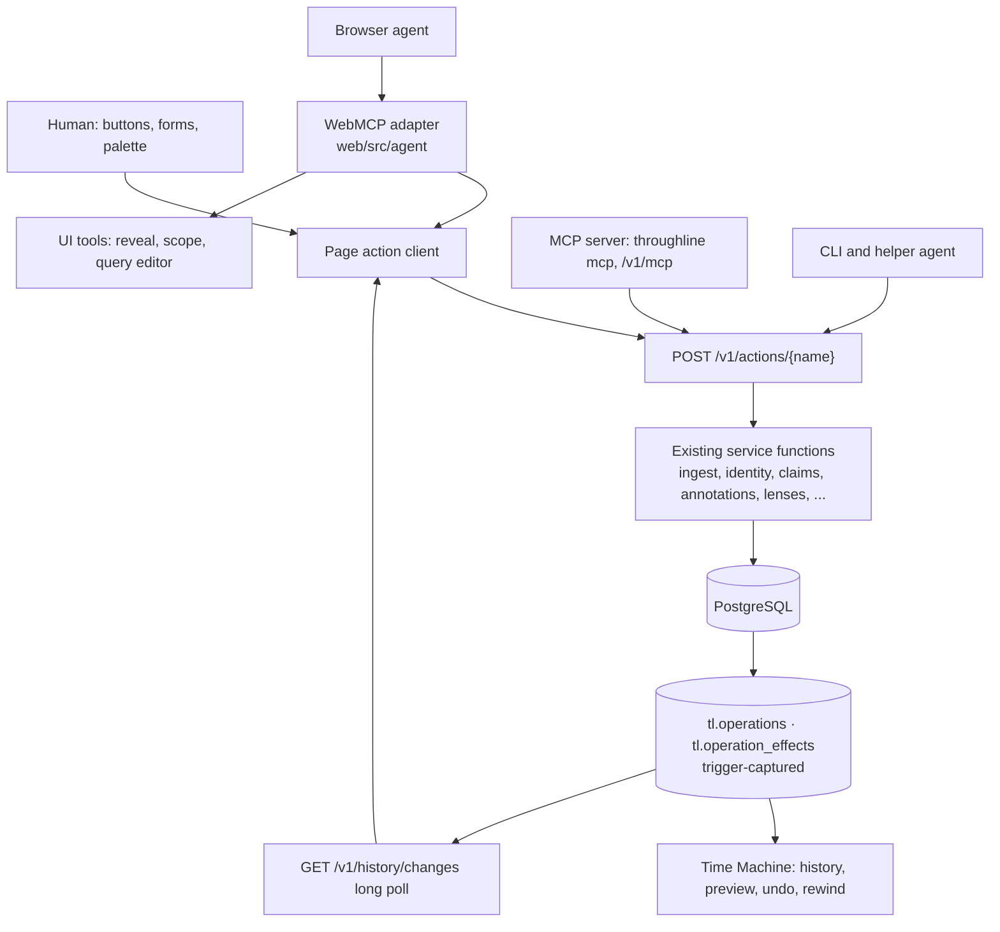

# Agents in the web interface: WebMCP, the action catalogue and the Time Machine

Status: design, not built. Written 2026-11-22 against `feat/web-ui` (9139a83 plus
the uncommitted web work) and `agent-retrieval` (4547753 plus the uncommitted
renames and lenses). Read with `docs/web/design.md` and `docs/web/backend.md`.

## Goal

A browser agent operating the live page can do anything the owner can do through
the interface. The interface shows everything an agent does while it is doing it.
Anything an agent changes can be undone: one operation, a whole agent session, or
everything after a checkpoint. Undo is checked against later work so it never
quietly overwrites it.

This changes one line of `design.md`: the interface stops being only an
observatory. It becomes the place where an agent's work is done in plain view and
taken back when it goes wrong.

## Principles

1. **One operation, every caller.** Each thing Throughline can do is one named
   *action* on the server. The page's own buttons, WebMCP tools, an MCP server,
   the helper agent and the CLI all call the same action. No caller gets its own
   implementation, so validation, authorisation, receipts and journaling cannot
   drift between them.
2. **The database keeps the record.** Rules that live in agent prose drift, so the
   journal of what changed is written by triggers inside the write transaction,
   not by handlers remembering to log. A write that should have been journaled
   and was not is refused.
3. **Undo is an operation too.** It is planned, previewed, checked against
   current state, journaled, and can itself be undone (that is redo).
4. **Reversibility is declared and tested.** Every action states whether it is
   `exact`, `compensating` or `irreversible`, and why. CI fails when the
   declaration and the journal disagree.
5. **Every action is drawn.** Every action has a form a human can run, a
   *reveal* that shows its result in the interface, and an entry in the Time
   Machine. A test fails when one is missing.
6. **Agents are not the owner.** A browser agent acts through a delegated agent
   session. That session has its own name in the journal, its own permission
   profile and spend cap, and a stop button.
7. **The WebMCP adapter stays thin.** The browser API is a Community Group draft
   and will change. Throughline's concepts will not. The adapter is one module
   that translates the catalogue into `document.modelContext` calls.

## Architecture



The existing HTTP routes stay. Each becomes a thin shell over its action, so
plugins, the SDK and the skill keep their contract, and route calls are
journaled the same way.

## 1. The action catalogue (server)

`src/throughline/actions/`. Each action is declared once:

| Field | Meaning |
|---|---|
| `name` | `noun_verb`, effect in the name: `annotations_retract`, `people_merge`, `lenses_run` |
| `group` | Feature area for progressive discovery: retrieval, people, claims, annotations, links, lenses, feeds, sources, transcripts, commitments, access, history, ui |
| `summary`, `description` | Purpose, when to use it, material side effect, any prerequisite the schema does not show. Under 500 characters. |
| `input` / `output` | Pydantic models, exported as JSON Schema. Parameter descriptions under 150 characters. |
| `kinds` | Token kinds and scopes allowed (enforced by the existing `require` / `require_unrestricted`) |
| `hints` | `read_only`, `untrusted_content`, `consequential`, `spends` (model, embedding), `egress` (outbound HTTP) |
| `reversibility` | `exact`, `compensating` or `irreversible`, plus a sentence on what undo does |
| `inverse` | The semantic inverse (section 4), or `generic` |
| `reveal` | How the interface shows the result: route plus drawer, e.g. `/people/{person_id}` or `?d=record:id={id}` |
| `long_running` | Returns an operation in `running` state; finishes in the background |

### HTTP

- `GET /v1/actions?group=&q=`: the catalogue, filtered to what this token and
  session may call. Each entry says why an unavailable action is unavailable
  (`unavailable_reason`).
- `POST /v1/actions/{name}` with an envelope:

```json
{
  "input": { "...": "..." },
  "operation_key": "client-chosen, reused on retry",
  "expected": { "hash": "…", "version": 7 },
  "mode": "commit | preview"
}
```

`operation_key` is the existing Idempotency-Key, under one name.
`expected` is the existing compare-and-set. `mode: preview` runs the action in a
transaction that is rolled back and returns the effects it *would* have had, with
a `plan_hash`. Commit with `plan_hash` fails with `PLAN_STALE` when the effects
would now differ. This generalises the cost gate's one-shot approval binding to
every write.

### Result convention

Every action answers with a value. It never throws to the agent, because WebMCP
does not reliably forward exception messages.

```json
{
  "status": "completed | preview | needs_confirmation | running | blocked | invalid_input",
  "operation_id": "op_01J…",
  "affected": [{ "kind": "person", "id": 41, "label": "Zibble", "version": 3, "hash": "…" }],
  "changes": [{ "kind": "person", "id": 41, "field": "display_name", "before": "Zib", "after": "Zibble" }],
  "persistence": "saved",
  "reveal": "/ui/people/41",
  "undo": { "available": true, "reversibility": "exact", "operation_id": "op_01J…" },
  "receipt": { "...": "the existing write receipt" },
  "error": null,
  "side_effects": "none"
}
```

Errors carry `code`, `message`, whether any side effect happened, whether a retry
makes sense, and a `recovery` call (`{"action": "records_get_context", "input":
{…}}`). A `VERSION_CONFLICT` points at a re-read, never at a blind retry.

### Coverage tests (what makes it complete)

`tests/test_v11_security_matrix.py` already lists every write route in
`WRITE_ROUTES` or `EXEMPT`. Add `tests/test_actions_coverage.py`:

- Every HTTP route, and every owner-only CLI command with no route (see the
  appendix), maps to an action or sits in `NOT_AN_ACTION` with a reason (plugin
  plumbing such as heartbeat and cursor; `migrate`; `configure-passwords`).
- Every action has a schema, a description within budget, a reversibility class,
  a `reveal`, a form in `/ui/actions` (section 6) and a Time Machine renderer for
  its effects.
- Every action marked `exact` is run in a fixture DB, undone, and the touched
  rows' hashes must equal their before-hashes.

## 2. The journal

Migration `00xx_journal.sql` (number after the web migrations; see "Before
starting").

```
tl.operations
  id            text primary key           -- op_<ulid>
  key           text                        -- operation_key / Idempotency-Key, unique per actor
  action        text                        -- catalogue name, or 'http:<METHOD path>' / 'cli:<command>'
  actor_token   bigint  -> tl.tokens
  actor_kind    text                        -- owner | agent | plugin | cli | system
  agent_session text    -> tl.agent_sessions
  client        text                        -- web | webmcp | mcp | cli | sdk | assistant
  asker         text
  parent_id     text    -> tl.operations    -- compound and undo-of
  undoes_id     text    -> tl.operations
  input         jsonb                       -- redacted (secrets, record text over 2 KB by reference)
  status        text   -- pending | running | committed | failed | cancel_requested | cancelled | undone | partially_undone
  reversibility text
  plan_hash     text
  spend_usd     numeric
  egress        jsonb                       -- what left the machine, from the provider ledger
  revision      bigint                      -- global, monotonically increasing on commit
  started_at, finished_at timestamptz

tl.operation_effects
  operation_id  text -> tl.operations
  seq           int
  tbl           regclass
  pk            jsonb
  op            text      -- insert | update | delete
  before        jsonb     -- full row image for mutable tables; key + hash for immutable ground truth
  after         jsonb
  before_hash, after_hash text

tl.checkpoints
  id, name, revision, created_by, note, at
```

### Capture

- The action layer opens an operation and runs `SET LOCAL
  throughline.operation_id = 'op_…'` inside the same transaction.
- One generic trigger, `tl.journal_effect()`, is attached `AFTER INSERT OR UPDATE
  OR DELETE` to every mutable `tl` table. It writes `to_jsonb(OLD)` and
  `to_jsonb(NEW)` with `tl.stored_hash`.
- Immutable ground truth (`messages`, `raw_payloads`, `location_track`) stores
  key and hash only, since the row outlives the operation anyway.
- When `throughline.require_operation = on`, which the action layer and the
  agent-session middleware set, a write without an operation id raises. A write
  path that skips the journal therefore fails in tests, not in an incident.
- Writes on separate connections (feeds create/drop/mark, lens run, run-batch,
  tick, rules evaluate, curate) carry the operation id with them. Today their
  receipts are not atomic with the write. Fix that first, or journal them as
  `parent_id` children.
- A migration test lists every `tl` table and fails when a new table has neither
  the trigger nor an exemption with a reason (caches, `semantic_cache`, the
  journal itself).

This one trigger closes most of inventory gap 1, the in-place updates that keep
no before-image today: people rename, identity ignore, channel register, lens
and rule definitions, feed settings, `external_ref`, token limits, link-type
synonyms, pause reasons. It also closes gap 2, hard deletes with nothing to
restore from: lens delete, feed drop, set drop, asker remove, candidate
link-type delete, scheme reconcile. The pre-image is now in the journal.

### What else gets journaled

All writes do, not only agent writes: HTTP routes, the page, the CLI (owner
connection, `client=cli`) and plugins. For plugin ingest, the journal keeps only
keys and hashes, so volume stays small. The Time Machine then shows the whole
picture, and an undo can see that a plugin wrote over a row after the agent did.
This also fixes the gap that CLI commands never reach `tl.audit_log`.

### Retention

The owner sets `THROUGHLINE_JOURNAL_DAYS` (default 180). Rows older than that
are compacted to `tl.operations` alone, without effects. They stay listed but
can no longer be undone. Effects behind a checkpoint are kept until the
checkpoint is deleted.

## 3. Long-running and interrupted work

WebMCP lets a cancellation race with completion, and a hard navigation can drop
a result. So every write has a durable outcome that can be looked up later:

- `operations_get(operation_id | operation_key)` returns status, effects summary,
  result and `undo`.
- `operations_cancel(operation_id)` sets `cancel_requested`. The answer says
  whether the work has stopped (`cancelled`) or only been asked to.
- Long-running actions (lens run and tick, commitments extract, noise run,
  curate, embed backfill, file import) return `running` with a
  `check_after_seconds`. Their work runs in the API process or a job, not in the
  tab, so it survives the tab closing.
- `GET /v1/history/changes?after=<revision>&wait=<0..25>` is a long poll over
  the journal (the same pattern as arrivals, so the "no push routes" rule
  holds). The page uses it to invalidate the TanStack queries whose kinds were
  touched. Human and agent then see the same state. Agents get it as
  `history_changes_since`.

## 4. The Time Machine (undo, redo, rewind)

### Planning an undo

`history_preview_undo({operations: [...] | session | after_checkpoint})` returns
a plan:

1. For each target operation, newest first, build the inverse:
   - **Semantic inverse** when the action declares one (table below). It is
     preferred because it keeps each domain's invariants: an entity merge is
     undone by the existing hash-checked split, not by poking rows.
   - **Generic restore** from `operation_effects`: delete inserted rows,
     restore updated rows to `before`, re-insert deleted rows. This is used for
     mutable registry and config tables.
2. **Conflict check.** For every effect, the current row hash must equal
   `after_hash`. When it does not, the plan lists the *dependent* operations
   that touched the row later, with their actors. Three choices are offered:
   - `undo_with_dependents`: those operations are added to the plan, newest
     first.
   - `skip_conflicting`: everything else is undone, and the conflicting part is
     reported as `partially_undone`.
   - Give up.
   Undo never silently overwrites later work.
3. The plan carries `plan_hash`, the exact rows and their before and after
   values, any spend that cannot be returned, and any egress that cannot be
   recalled.

`history_undo(plan_hash)` executes it as one operation (`undoes_id` set) in one
transaction. It re-checks every hash and fails with `PLAN_STALE` if anything
moved. Afterwards it verifies that the touched rows hash to their target
values; a mismatch rolls back and is reported, never committed. Redo is
`history_undo` on the undo operation.

`history_rewind_preview(checkpoint, scope)` and `history_rewind` undo every
operation after a checkpoint. `scope` is one agent session, one actor, or
everything. Checkpoints are made explicitly (`history_checkpoint_create`) and
automatically when an agent session starts, so "undo everything this agent did"
is always one call and one button.

### Inverses for the current surface

| Action | Undo | Class |
|---|---|---|
| Entity merge | Existing `/v1/entities/split` (hash-checked) | exact |
| Identity merge | Existing split, *plus* a hash check against the snapshot, which today overwrites edits made after the merge | exact after fix |
| Identity attach/detach, identifier status | Opposite call plus restore of `asserted_by` / `updated_at` from effects | exact |
| People rename, identity ignore, registry upserts | Generic restore | exact |
| Link create | Supersede to `withdrawn` (new status) | exact in effect |
| Link patch / supersede | Restore from `link_history` pre-image; withdraw the successor | exact |
| Annotation create / supersede | Retract the new one; reinstate the superseded one | exact, needs reinstate |
| Annotation or claim retract | Reinstate (new sanctioned transition) | exact, needs reinstate |
| Claim create / merge / split / promote / contradict | Retract new claims, reinstate superseded ones, mark relations inactive | compensating: corroborating `claim_sources` stay, flagged `undone_by` |
| Proposal decide (accept) | Undo the created object through its own inverse; proposal goes to `reverted` | follows the object |
| Lens define (upsert) | Generic restore of `table_defs`, then regenerate views | exact |
| Lens delete | Re-insert defs, rows and provenance from effects, then regenerate views | exact |
| Lens run / row edit | New row versions superseding the run's versions | exact for data; spend stays spent |
| Rules upsert | Generic restore | exact |
| Feed create / drop / settings | Generic restore (drop re-inserts the same id) | exact |
| Feed mark | Rewind the cursor (new owner-sanctioned transition, compare-and-set) | exact, needs rewind |
| Source pause / resume | Opposite call plus restored reason and `channel_pauses` row | exact |
| Track retire | Existing `--restore` | exact |
| Asker grants, labels, egress | Opposite call; reconstructed from `access_events` and effects | exact |
| Channel register, manifest | Generic restore | exact |
| Commitment extract / assess / audit, `external_ref` | Assessments: a superseding `undone` assessment; commitments: hidden by an annotation; `external_ref`: generic restore | compensating |
| Ingest messages (agent or page import) | Ignore annotations on the new versions, and re-point the head at the prior version where one existed | compensating. Physical deletion needs purge. |
| Detect visits | Withdraw the rule's links and restore the removed ones | exact |
| Semantic SQL, match, recall escalation, embed, librarian | Nothing to undo in data; spend and egress listed | irreversible spend |
| Rules evaluate (webhook), alert command | The outbound call happened | irreversible egress |
| Approval decide | Spend that ran cannot be returned; an unused approval can be revoked | irreversible once used |
| Embedding-channel disable | Embeddings are moved to `tl.embeddings_trash` for the retention window instead of deleted, so undo restores them without re-embedding | exact within retention |
| Purge, migrate, token create | Not undoable; not offered to agents | irreversible |

### Schema changes the Time Machine needs

These are deliberate edits to existing guarantees, each guarded so that only the
undo engine can use it. The engine sets `throughline.time_machine = on` from an
owner-authorised operation, and each transition is written to `status_history`:

- `tl.derived_guard`: allow `retracted → active` and `superseded → active`
  (*reinstate*) for claims and annotations.
- `tl.links`: a `withdrawn` status.
- `tl.consumers`: a compare-and-set rewind of `seen_to` for feeds.
- `tl.proposals`: a `reverted` status.
- `identity.split`: a hash check against the merge snapshot.
- Embedding-channel disable: move rows to trash instead of deleting them.

### Last resort

The journal is the main tool. Behind it sit the existing snapshot backups and
restore drills. `purge`, `migrate` and `restore` take an automatic backup
first. These are never agent actions.

## 5. Agent sessions and permission

The page holds an owner token. A browser agent must not get the owner token's
full power just because it runs in the page.

- `tl.agent_sessions`: `id`, `label` (as the agent reports it, plus "WebMCP in
  this tab"), `owner_token`, `profile`, `spend_cap_usd`, `expires_at`,
  `checkpoint_id`, `stopped_at`.
- The first WebMCP call opens a consent sheet in the page. The owner chooses a
  profile and a duration. The page creates the session with `POST
  /v1/web/agent-sessions` (owner only). It is not a token: it narrows the token
  the page already has.
- From then on, every WebMCP-originated request carries `X-Throughline-Client:
  webmcp` and `X-Throughline-Agent-Session`. The server applies the profile and
  the journal names the session. Add `webmcp` and `mcp` to the allowed client
  tags (`api/__init__.py:115`), so these calls show in the Reads lane instead of
  being hidden as `web`.

| Profile | May call without asking | Needs a click from the human | Never |
|---|---|---|---|
| Observe | read-only actions, UI tools | — | writes |
| Edit (default) | `exact` writes, the session's own sets and queries | `compensating` writes, anything that `spends` over a per-call threshold | `irreversible` |
| Full | `exact` and `compensating` writes, spend within the cap | `consequential` actions, egress, owner-only administration | purge, migrate, token create |

When an action needs a click, it answers `needs_confirmation` with the preview
and an `approval_id`, and the page shows an approval card in the agent HUD. The
WebMCP tool call stays open for up to 120 s waiting for the click. After that
the agent can `operations_get` the approval later. An `approved: true` argument
from the agent means nothing. Approval is bound to the session, the action, the
`plan_hash` and an expiry, reusing the cost gate's binding. Agents can never
decide approvals or proposals for their own session.

Restricted askers and agent tokens keep everything they have today. A session
can only narrow what its token may do, never widen it.

## 6. What is drawn

### Agent HUD (every screen, while a session is active)

- A band under the header with the agent's label, profile, elapsed time, spend
  against its cap, and **Pause** and **Stop**. While paused, tools answer
  `paused_by_user`. Stop ends the session, aborts every registration signal and
  offers "Undo this session".
- A step list (reusing the helper's `HelperPanel` step renderer). Each step
  shows the tool, its input summary, status, the affected objects as chips, and
  an undo glyph.
- Pending confirmations as cards with the preview diff.
- Presence: objects an agent just read or changed get a short brass halo where
  they appear (rows, chart marks, drawer). `prefers-reduced-motion` reduces this
  to an outline. Reads never move the human's view. Only `ui_reveal` navigates,
  and it says so in the step list.

### Time Machine screen (`/ui/history`)

- One lane per actor (owner, CLI, each plugin, each agent session) on the time
  grammar of `design.md`: brass now-rule, checkpoints as tall ticks, and
  reversibility glyphs on every operation (↺ exact, ≈ compensating,
  ⊘ irreversible, $ spend, ↗ egress).
- Each operation card shows the action, actor, input summary, a field-level
  diff of its effects (before and after, record text through `Sensitive`),
  links to every affected object, and dependents. **Undo** opens the preview
  plan first.
- A scrubber. Dragging it to a point shows "everything after here": counts by
  kind, the diff, and what a rewind would leave untouched. **Rewind to here**
  opens the same preview.
- Filters for actor, session, action group, object, status and reversibility.
- The URL holds the filters, so "what did the agent do yesterday" is a link.

### Elsewhere

- **Record drawer**: a *History* tab listing the operations that touched this
  record, including annotations, links, claims and lens rows about it.
- **Actions screen** (`/ui/actions`): the whole catalogue by group. Each action
  has a form generated from its JSON Schema (`ajv` is already a dependency), its
  hints and reversibility, who may call it, recent invocations, and per-action
  agent metrics (success, invalid arguments, undo rate). Running an action here
  takes the same path an agent takes. This is the guarantee that every function
  of the app is visible and usable by a human.
- **Live**: a *Writes* lane beside the Reads lane, fed by the change feed.
- **Ledger → Audit**: reads the journal and `tl.audit_log` through a real route,
  instead of the arrivals tail it uses today.
- **Settings → Agents**: active and past sessions, profiles, default caps,
  WebMCP on or off, journal retention, checkpoints.

## 7. The WebMCP adapter (`web/src/agent/`)

```
web/src/agent/
  index.ts         feature-detect, install once after bootstrap, uninstall on sign-out or token change
  catalog.ts       GET /v1/actions → tool descriptors (cached, refreshed on catalogue revision)
  register.ts      document.modelContext.registerTool(tool, { signal }) for each direct tool
  execute.ts       envelope, operation_key handling, session headers, result shaping
  uiTools.ts       client-only tools: context, reveal, scope, query editor, highlight
  session.ts       consent sheet, pause/stop, confirmations
  hud/             the HUD components
```

- **Registration** happens once per signed-in page, at the app boundary, never
  on render. One `AbortController` per install. A readiness gate registers all
  direct tools or none. Screen changes do not re-register anything: UI tools
  work from any screen and navigate when they have to.
- **Detection.** Use native `document.modelContext` when present. Otherwise,
  with a setting (off by default) and always in e2e, load the bundled
  `@mcp-b/global` polyfill (6.2.0 today; pin it). It is bundled, so the CSP
  (`script-src 'self'`, `connect-src 'self'`) needs no change and the
  no-egress spec still holds.
- **Direct tools** (about 30; within Chrome's budgets):
  - Orientation: `throughline_context`. Returns token and session profile,
    scopes and timezone, current screen, open drawers, selection, the visible
    panels and their SQL, the veil state, the journal head revision, and the
    last five operations in this session.
  - Retrieval: `records_find`, `records_timeline`, `orient`, `sql_query`,
    `records_get_context`, `people_lookup`, `people_brief`, `catalogue_describe`.
    All of these carry `untrusted_content`, and record text in their results is
    wrapped as `{"untrusted": true, "text": …, "source": "m:123"}`.
  - Common writes: `annotations_create`, `annotations_retract`, `claims_create`,
    `claims_retract`, `links_create`, `links_withdraw`, `people_merge`,
    `people_rename`, `lenses_define`, `lenses_run`, `feeds_mark`,
    `sources_pause`, `sources_resume`, `queries_save`, `boards_pin`.
  - History: `operations_get`, `operations_cancel`, `history_list`,
    `history_preview_undo`, `history_undo`, `history_checkpoint_create`,
    `history_changes_since`.
  - UI: `ui_reveal(target)`, `ui_set_scope(from, to, tz)`,
    `ui_open_query(sql, run?)`, `ui_highlight(refs)`.
- **The full catalogue** is reachable through three meta tools:
  `actions_search(query, group?)`, `actions_describe(name)` and
  `actions_run(name, input, operation_key?, mode?)`. A new server action is
  usable by agents the day it lands, and the direct list stays small. This does
  not depend on any agent host's own tool search.
- **Retries.** Every write tool takes an optional `operation_key`. Its
  description says: reuse it when retrying the same logical change. Without
  one, the adapter generates a key and returns it, so a later
  `operations_get(operation_key)` can still reconcile.
- **Hints** map onto WebMCP annotations: `readOnlyHint`, `untrustedContentHint`,
  and `consequentialHint` for irreversible, spend and egress actions.
- **No bypass.** The import screen's raw `fetch` calls
  (`sourcesAdd/IngestRunner.tsx`, `HttpDoor.tsx`) move onto the action client,
  so page imports are journaled and undoable like everything else.

### Prerequisite fixes found on the way

- Deep links into Query are broken: `?ask=` and `?sql=` are sent by Loom, People
  and Live, but Query reads only `?q=`, `?spec=` and `?run=`. `ui_open_query`
  needs one working form.
- The Ledger tab, the Query editor text, the helper panel and the Live filters
  are not in the URL. `ui_reveal` needs them there, and so does a shareable
  Time Machine link.

## 8. Beyond the browser

- **MCP server**: `throughline mcp` (stdio) and `POST /v1/mcp` (streamable HTTP)
  generated from the same catalogue, with the same session, journal and undo.
  Claude Code, Hermes or any MCP host gets parity with the browser, and its work
  shows up in the Time Machine as its own lane. SKILL.md gains a short "undo
  what you did" section.
- **The helper agent** (`assistant/tools.py`) keeps its read-only belt, but its
  tool definitions come from the catalogue's retrieval group, so there is one
  source of descriptions.
- **MCP Apps** (later): serve a view spec or a Time Machine card as an MCP App,
  so a host can render a Throughline panel inline. This is optional and comes
  after everything above.

## 9. Evaluation

Grade the final database state, never the agent's own account of it.

- `bench/behaviours.py` gains agent behaviours driven through `actions_run`,
  checked with SQL. Repeat each one several times and run it against more than
  one model.
- Playwright specs drive tools through `document.modelContext.executeTool` (the
  polyfill) and assert both the database state and what the page draws: HUD
  step, halo, Time Machine card.
- The adversarial set, using the public twin's twelve people:
  - two people with the same name
  - a human edit between the agent's read and its write
  - a lost response followed by a retry with the same key
  - cancellation just before and just after commit
  - a stale plan
  - a partially failed batch
  - navigation during a running lens
  - a result set that needs pagination
  - a record whose text tells the agent to merge everyone
  - undo after a plugin re-ingested the same row
  - rewind of a session with a dependent owner edit
- Metrics per action and overall: correct completion, wrong-object and duplicate
  writes, calls and tokens per task, invalid-argument rate, recovery success,
  undo rate, unnecessary confirmations, and UI fallback rate (agent clicked the
  page instead of using a tool).

## Plan

| Phase | Builds | Shippable value |
|---|---|---|
| 0. Before starting | Merge `feat/web-ui` with `agent-retrieval` (renumber `0060_web`/`0061_assistant` to after `0062`; settle the `statement_error` exposure and builtins policy conflicts). Fix Query deep links. Put Ledger tab and Query state in the URL. Route import writes through the client. | A clean base |
| 1. Journal | `tl.operations`, effects trigger, `require_operation`, change feed, CLI journaling, read-only Time Machine screen, record History tab, Live Writes lane | Every change by every actor is visible |
| 2. Catalogue | `src/throughline/actions`, `/v1/actions`, routes as thin shells, coverage tests, `/ui/actions` with generated forms | Every function is listed, described and runnable by a human |
| 3. Undo | Inverse table above, schema changes, preview/undo/redo/rewind, checkpoints, conflict and dependents handling, `exact` round-trip tests | Mistakes can be taken back safely |
| 4. WebMCP | Adapter, agent sessions and profiles, consent sheet, HUD, confirmations, polyfill e2e | Browser agents operate the app in plain view |
| 5. Parity and evals | MCP server, helper on the catalogue, bench agent behaviours, metrics on `/ui/actions` | Same power from any agent; measured |

Phases 1 and 2 can run side by side. Phase 4 should not ship before phase 3, so
that agents never get write tools without undo.

## Decisions for the owner

1. **Name.** "Time Machine" is the working name. "Rewind" and "History" are
   alternatives. Storage names stay `tl.operations` and friends either way.
2. **Agent sessions created from the page.** `design.md` keeps token minting on
   the box. A session narrows an existing token rather than minting one, so this
   design treats it as allowed. Confirm.
3. **Undoing an ingest.** Hide (ignore annotations plus head re-point; the rows
   stay as immutable ground truth) or physically remove (purge machinery,
   irreversible). This design hides.
4. **Reinstate and rewind transitions.** These loosen `derived_guard` and the
   forward-only feed cursor, for the undo engine only. Confirm.
5. **Journal everyone, or agents only.** This design journals everyone,
   including plugins (keys and hashes only for ground truth). Confirm the
   retention default (180 days).
6. **Default profile** for a new browser agent session: Edit, with a $1 spend
   cap and 2 hours. Adjust as you like.

## Appendix: inventory this design rests on

The 2026-11-22 survey of `agent-retrieval` and `feat/web-ui` found:

- **Write surface.** Inventory section A (HTTP) covers 83 POST, PUT, PATCH and
  DELETE route declarations (about a dozen are reads such as find, sql and
  plans, plus the deprecated consumer aliases) across core, identity, claims, annotations, links, link types, feeds, lenses,
  rules, coverage, transcripts, commitments, source health, approvals,
  proposals and sets. Section B (owner-only CLI with no route) covers tokens,
  limits, askers and grants, labels and egress, embed channels, track retire,
  purge, backups and curate. No section B command writes `tl.audit_log` today.
- **Existing history** to build on:
  - `tl.audit_log`, `write_receipts`, `link_history` (full pre-images),
    `status_history`, `entity_events`, `identity_events`, `access_events`,
    `provenance`, `proposals`, `approvals`, ledgers, traces
  - version chains on `messages` and `table_rows`
- **Inverses that already exist:**
  - entity merge ↔ split (exact)
  - identity merge ↔ split (overwrites later edits)
  - track retire ↔ restore
  - grant ↔ revoke and label ↔ unlabel
  - pause ↔ resume (loses the reason)
  - identifier status, using `previous_status`
- **No before-image** for in-place updates: people rename, identity ignore,
  registry upserts, channel register, lens and rule definitions, feed settings,
  `external_ref`, token limits, link-type synonyms, pause reasons.
- **Hard deletes:** lens delete, feed drop, sets, embedding-channel disable,
  asker remove, candidate link types, scheme reconcile, purge.
- **Terminal transitions:** feed cursor, claim and annotation retract, proposal
  and approval decisions, claim corroboration.
- **Not atomic with their receipt:** feeds create/drop/mark, lens
  run/run-batch/tick, rules evaluate.
- **Page shell.**
  - The CSP (`script-src 'self'; connect-src 'self'; worker-src 'none';
    frame-ancestors 'none'`) allows bundled tool registration as is.
  - The router, drawer store and scope store can all be driven outside React,
    which is what `ui_reveal` needs.
  - The helper's step-event stream and `HelperPanel` renderer are the model for
    the HUD.
